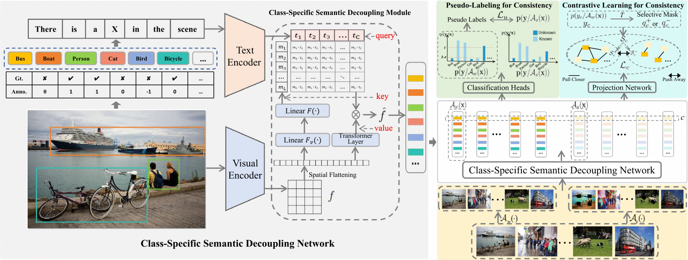

# Prompt-Guided Consistency Learning for Multi-Label Classification with Incomplete Labels

[](https://doi.org/10.1016/j.neunet.2025.107604)
[](https://wangshouwen.github.io/PGCL/)

Official PyTorch implementation of "Prompt-guided consistency learning for multi-label classification with incomplete labels"

> Addressing insufficient supervision and improving model generalization are essential for multi-label classification with incomplete annotations, i.e., partial and single positive labels. Recent studies incorporate pseudo-labels to provide additional supervision and enhance model generalization. However, the noise in pseudo-labels generated by the model tends to accumulate, resulting in confirmation bias during training. Self-correction methods, commonly used approaches for mitigating confirmation bias, rely on model predictions but remain susceptible to confirmation bias caused by visual confusion, including both visual ambiguity and similarity. To reduce visual confusion, we propose a prompt-guided consistency learning (PGCL) framework designed for two incomplete labeling settings. Specifically, we introduce an intra-category supervised contrastive loss, which imposes consistency constraints on reliable positive class samples in the feature space of each category, rather than across the feature space of all categories, as in traditional inter-category supervised contrastive loss. Building on this, the distinction between true positive and visual confusion samples for each category is enhanced through label-level contrasting of the same category. Additionally, we develop a class-specific semantic decoupling module that leverages CLIP's strong vision-language alignment capability, since the proposed contrastive loss requires high-quality label-level representations as contrastive samples. Extensive experimental results on multiple datasets demonstrate that our method can effectively address the problems of two incomplete labeling settings and achieve state-of-the-art performance.

## Pipeline


## Installation

```shell
pip install -r requirements.txt
```

Training needs one CUDA GPU; stage 2 on MS-COCO uses about 22 GB. The partial-label MS-COCO and VOC loaders call `wget` and `unzip`.

## Data Preparation

Final folder structure should be

```
datasets/dataset
├── VOCdevkit
│   ├── VOC2007                         # partial labels: downloaded on the first run
│   ├── VOC2012/JPEGImages              # single positive
│   └── data                            # single positive: written by format_pascal.py
├── MSCOCO_2014
│   ├── train2014, val2014, annotations # downloaded on the first run of the partial-label setting
│   └── data                            # single positive: written by format_coco.py
├── NUS-WIDE
│   ├── Flickr                          # images, as the image lists name them
│   ├── Concepts81.txt, ImageList, TrainTestLabels          # official NUS-WIDE metadata
│   ├── dpt_train_set.npy, dpt_test_set.npy, category.json # partial labels: see below
│   └── data                            # single positive: see below
└── CUB_200_2011
    ├── images, images.txt, train_test_split.txt, attributes, attributes.txt
    └── data                            # written by format_cub.py
```

### Partial-Label Setting

VOC 2007 and MS-COCO need no preparation. For NUS-WIDE, put the official download in `NUS-WIDE/` and run

```shell
python datasets/nuswid_formatted_generate.py --root ./datasets/dataset
```

### Single-Positive-Label Setting

Download [VOC 2012](http://host.robots.ox.ac.uk/pascal/VOC/), [MS-COCO](https://cocodataset.org/) and
[CUB-200-2011](https://www.vision.caltech.edu/datasets/cub_200_2011/) (move `attributes.txt` into `CUB_200_2011/`), then

```shell
python datasets/single_label/format_coco.py --load-path ./datasets/dataset --save-path ./datasets/dataset/MSCOCO_2014/data
python datasets/single_label/generate_single_label.py --dataset MSCOCO_2014
python datasets/single_label/format_pascal.py --load-path ./datasets/dataset --save-path ./datasets/dataset/VOCdevkit/data
python datasets/single_label/generate_single_label.py --dataset VOCdevkit
python datasets/single_label/format_cub.py --load-path ./datasets/dataset --save-path ./datasets/dataset/CUB_200_2011/data
python datasets/single_label/generate_single_label.py --dataset CUB_200_2011
```

NUS-WIDE has two setups. LargeLoss: put `formatted_{train,val}_{images,labels}.npy` from
[Zenodo](https://zenodo.org/records/10162606) in `NUS-WIDE/data/` and run
`python datasets/single_label/generate_single_label.py --dataset NUS-WIDE`.
SPLC: the split ships in `NUS-WIDE/data/`; run `python datasets/single_label/format_splc_nus.py`.

## Training and Evaluation

Each setting trains in two stages; pick the dataset (and the known-label share or setup) at the top of the scripts.

Partial labels (MS-COCO, 10&#37; known labels by default):

```shell
bash coco_pl.sh && bash coco_pl2.sh
python test.py --setting pl --dataset COCO2014 --backbone RN101 --image_size 448 \
    --resume ./checkpoint/COCO2014_pl/0.1_stage2/checkpoint_best.pth
```

Single positive label (MS-COCO, LargeLoss setup by default):

```shell
bash coco_spl.sh && bash coco_spl2.sh
python test.py --setting spl --dataset MSCOCO --backbone RN50 --image_size 224 \
    --resume ./checkpoint/MSCOCO_spl2/checkpoint_best.pth
```

## Inference

```shell
python predict.py --checkpoint ./checkpoint/COCO2014_pl/0.1_stage2/checkpoint_best.pth --images my_photos/
```

The class names, their order, the backbone and the input size are read from the checkpoint.

## Citation
If you find it helpful, please consider citing
```bibtex
@article{wang2025prompt,
  title   = {Prompt-guided consistency learning for multi-label classification with incomplete labels},
  author  = {Wang, Shouwen and Wan, Qian and Zhang, Zihan and Zeng, Zhigang},
  journal = {Neural Networks},
  volume  = {190},
  pages   = {107604},
  year    = {2025},
  doi     = {10.1016/j.neunet.2025.107604}
}
```
